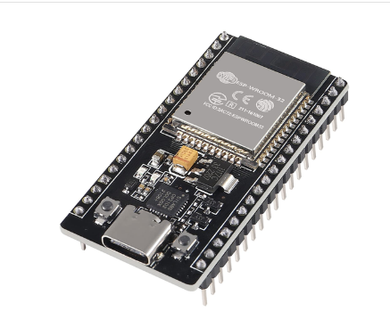

# ĐỀ TÀI GIỮA KỲ: HỆ THỐNG IoT GIÁM SÁT CHẤT LƯỢNG NƯỚC SỬ DỤNG ESP32
## 📌 1. Đặt bài toán (Problem Statement)

💡 **Bối cảnh thực tế**

Nước là nguồn tài nguyên thiết yếu trong sinh hoạt, sản xuất nông nghiệp và nuôi trồng thủy sản. Tuy nhiên, chất lượng nước có thể thay đổi theo thời gian do các yếu tố môi trường, hoạt động sản xuất và quá trình ô nhiễm.
⚠️ **Vấn đề cần giải quyết**

Trong thực tế, việc kiểm tra chất lượng nước ở nhiều hộ gia đình, bể chứa hoặc mô hình nuôi trồng thủy sản vẫn chủ yếu dựa vào phương pháp đo thủ công. Phương pháp này có một số hạn chế:

- ⏱️ Không thể theo dõi chất lượng nước liên tục.
- 📉 Khó phát hiện kịp thời những thay đổi bất thường.
- 📍 Người dùng phải trực tiếp đến vị trí lấy mẫu để kiểm tra.
- 📱 Thiếu khả năng giám sát và cảnh báo từ xa.

🚀 **Ý tưởng đề xuất**

Xuất phát từ nhu cầu theo dõi chất lượng nước thường xuyên và thuận tiện hơn, đề tài đề xuất xây dựng một hệ thống giám sát chất lượng nước ứng dụng công nghệ IoT.

Hệ thống sử dụng ESP32 kết hợp với các cảm biến để thu thập thông số nước, truyền dữ liệu qua Internet và cho phép người dùng giám sát từ xa trên máy tính hoặc điện thoại thông qua Node-RED Dashboard.
## 🎯 2. Mục tiêu đề tài (Project Objectives)

- 🔬 Xây dựng thiết bị có khả năng đo và giám sát một số thông số chất lượng nước.
- ⚙️ Thu thập và xử lý dữ liệu cảm biến bằng ESP32.
- 🌐 Truyền dữ liệu lên hệ thống giám sát thông qua giao thức MQTT.
- 📊 Xây dựng giao diện Node-RED Dashboard để hiển thị thông số theo thời gian thực.
- 🔔 Phát hiện và cảnh báo khi các thông số đo vượt ngưỡng cài đặt.
## 🛠️ 3. Nội dung chính (Main Contents)

Hệ thống dự kiến phát triển các chức năng sau:

| STT | Chức năng | Mô tả |
|:---:|---|---|
| 01 | 🔬 Đo pH | Xác định độ axit hoặc kiềm của nước |
| 02 | 💧 Đo TDS | Đo tổng chất rắn hòa tan |
| 03 | 🌫️ Đo độ đục | Đánh giá mức độ đục của nước |
| 04 | 🌡️ Đo nhiệt độ | Theo dõi nhiệt độ nước |
| 05 | ⚙️ Xử lý dữ liệu | ESP32 thu thập và xử lý dữ liệu cảm biến |
| 06 | 📡 Truyền thông | Gửi dữ liệu qua Wi-Fi và MQTT |
| 07 | 📊 Giám sát | Hiển thị dữ liệu trên Node-RED Dashboard |
| 08 | 🔔 Cảnh báo | Cảnh báo khi thông số vượt ngưỡng |
## 🔌 4. Phần cứng dự kiến 

| Linh kiện | Hình ảnh | Chức năng |
|---|---|---|
| ESP32 DevKit V1 |  | Vi điều khiển trung tâm |
| pH Sensor |  | Measures water pH |
| TDS Sensor |  | Measures total dissolved solids |
| Turbidity Sensor || Measures water turbidity |
| DS18B20 |  | Measures water temperature |
| ADS1115 |  | External ADC |
| OLED Display |  | Displays measurement results |
| RGB LED & Buzzer |  | Local warning system |
